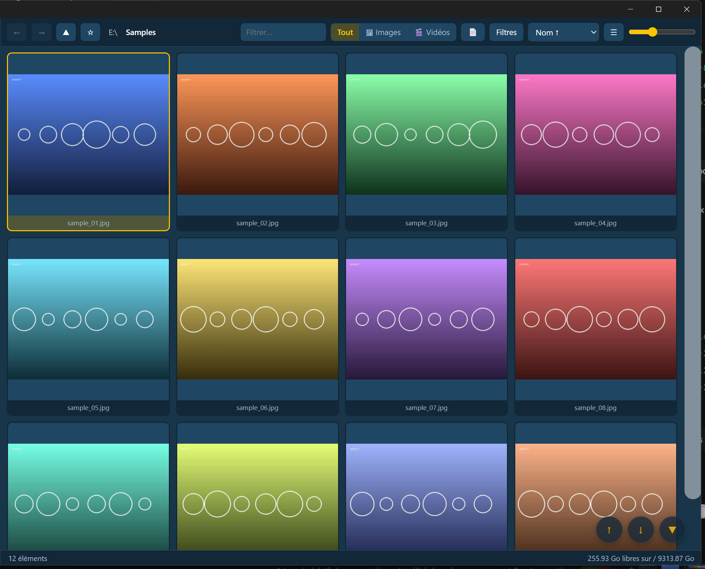

# ⚡ SpeedDisplay

**A very fast image & video viewer for Windows**, in the spirit of XnView MP / IrfanView — Rust backend (Tauri 2), TypeScript frontend, hardware video decoding (WebView2).



## Features

- **Virtualized thumbnail grid and details view** — both stay smooth with tens of thousands of files
- **Parallel thumbnail generation** (rayon, all CPU cores) with a persistent SQLite + JPEG/PNG cache; what is on screen is generated first, then the next screen; a slow picture never holds the others, and switching folder abandons the previous one at once
- **One name order everywhere** (folder tree and listing, natural numbers); the recursive "show everything" view reads like the tree: a folder's files, then each subfolder in turn
- **Damaged files still get a thumbnail**: when the native decoder gives up on a truncated picture, FFmpeg renders the part that is there
- **Images**: JPEG, PNG, GIF, BMP, TIFF, WebP, ICO, TGA, PNM — plus AVIF, HEIC, JXL, JP2, PSD, SVG through FFmpeg (depending on your FFmpeg build)
- **RAW**: near-instant display via the embedded JPEG preview (CR2, CR3, NEF, ARW, RW2, RAF, ORF, DNG…)
- **Videos**: thumbnails, animated hover previews (live or pre-generated), direct playback, lossless MKV→MP4 remux, NVENC transcode as a last resort
- **Viewer**: windowed or true fullscreen, wheel zoom anchored on the cursor, hold the right button for a 100 % loupe you can drag and zoom, neighbor preloading
- **Two-page view**, like a PDF reader: pictures side by side, optionally with the first one alone as a cover page; remembered per folder (subfolders keep their own setting)
- **Video player**: resumes where you stopped, compact floating transport bar in fullscreen, wheel over the bar to seek
- **Listed in Explorer's "Open with" menu** for every supported image, RAW and video type (registered for the current user at startup; the default app is never changed behind your back)
- **Mouse Back/Forward buttons** go back and forth through visited folders, like in a browser; with a picture or video open they step through the display modes (fullscreen, window, thumbnails)
- **Safe file operations**: copy, cut, paste, drag and drop, merge of same-name folders, overwrites go to the **Recycle Bin**, a move never deletes its source before the copy is verified, conflict dialog with a side-by-side comparison
- **Windows clipboard interop**: copy in SpeedDisplay, paste in Explorer, and the other way round
- Ratings, colour labels, keywords and rotations that follow the file when it is moved, renamed or copied; duplicate detection, search, lossless EXIF rotation, XMP sidecars
- Favourites (with hidden ones), resolution / megapixel / ratio columns, capture date and camera in the properties
- 24 themes, 6 languages, fully configurable shortcuts, persistent settings
- **Cache housekeeping**: least-recently-used eviction, optional wipe of converted videos on exit, and removal of entries whose original file can no longer be found

## Setup (one time)

Open **PowerShell as administrator**:

```powershell
Set-ExecutionPolicy -Scope Process Bypass -Force
.\setup-windows.ps1
```

The script installs via winget: Visual Studio Build Tools (C++), Rustup, Node.js LTS, FFmpeg (Gyan build). **Close and reopen your terminal** afterwards (PATH refresh).

## Development

```cmd
npm install
run-dev.cmd
```

The first Rust build takes 5–10 minutes (Tauri and dependencies); later builds are incremental.

## Building the installer

```cmd
build-release.cmd
```

The NSIS installer is produced in `src-tauri\target\release\bundle\nsis\` (NSIS is fetched automatically by Tauri on first build).

## Architecture

```
├── core/            # Pure Rust crate: scan, thumbnails, SQLite cache, RAW, FFmpeg
│                    #   tested independently: cargo test --release
├── src-tauri/       # Tauri 2 app: commands, events, state, icons
├── src/             # TypeScript frontend (Vite): virtualized grid, viewer, player
├── index.html
├── setup-windows.ps1
├── run-dev.cmd
└── build-release.cmd
```

Design notes:

- Files are served to the frontend through Tauri's **asset protocol** (`convertFileSrc`) — no local HTTP server. The asset scope is intentionally broad (`**`) so any folder can be browsed; the app runs fully offline.
- The thumbnail cache is invalidated by (path, mtime, file size, thumbnail size).
- Videos play as-is when the container/codec is WebView2-compatible, otherwise stream-copy remux (fast, lossless), otherwise `h264_nvenc` transcode.
- An atomic `generation` counter prevents stale thumbnails from appearing during rapid folder switches.

## Known limitations

- HEIC/AVIF/JXL support depends on the codecs included in the winget FFmpeg build.
- `core` and `src-tauri` are intentionally **outside a Cargo workspace** (version constraints).
- Rotating a RAW file is shown in SpeedDisplay and written to the file's own tag, but Lightroom and Bridge keep their own orientation for raws and will not pick it up (no sidecar file is created).
- Dragging files **out** of SpeedDisplay into Explorer is not supported (dragging in is); use copy / paste instead.
- Diagnostics: decodes that never finish, or crash, are named in `speeddisplay.log` in the cache folder.

## Support

If SpeedDisplay makes your photo sorting faster:

[](https://ko-fi.com/hypedigger)

## License

[MIT](LICENSE)
